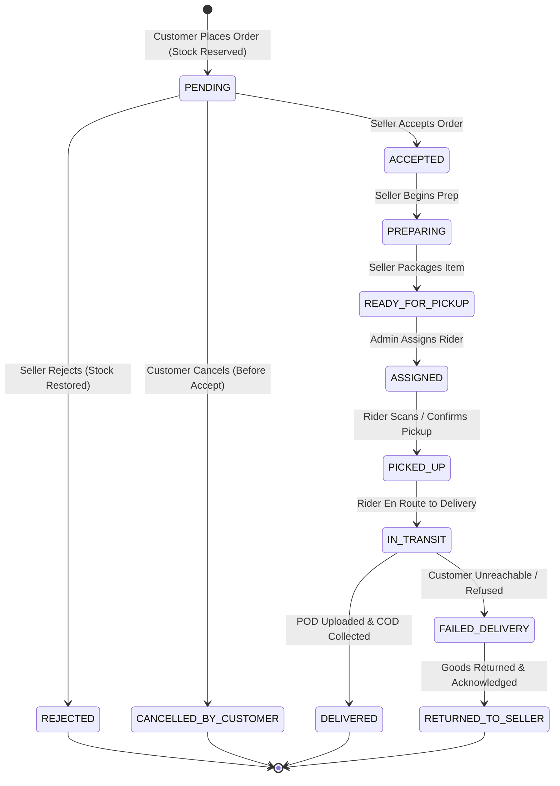

# MOVLI — MASTER ARCHITECTURE & BUSINESS SPECIFICATION
**Version:** 1.0.0 (Pre-Development Blueprint)  
**Target Market:** Lingayen, Pangasinan, Philippines  
**Brand Statement:** *Your local marketplace. Your trusted riders. Everything in motion.*  
**Tagline:** *Everything moves with Movli.*  
**Core Pillars:** SHOP · SELL · DELIVER  

---

## 1. EXECUTIVE SUMMARY

**Movli** is an integrated hyper-local multi-vendor e-commerce and on-demand delivery ecosystem engineered specifically for provincial town hubs, launching initially in **Lingayen, Pangasinan**. Unlike national e-commerce giants (Shopee, Lazada) characterized by 3-to-7-day delivery cycles and high seller take-rates, or motorcycle taxi apps (Grab, Foodpanda) that prioritize fast-food franchises with prohibitive commissions (20-30%), Movli targets local native retail, specialty delicacies (e.g., Lingayen bagoong, native cakes, local produce), neighborhood groceries, apparel, and daily essentials delivered within **30 to 60 minutes**.

The platform converges three native stakeholders into a single, synchronized platform:
1. **Buyers (SHOP):** Mobile-first local shopping catalog, transparent single-seller basket checkout, fixed local delivery fee, and reliable Cash-on-Delivery (COD).
2. **Merchants (SELL):** Frictionless digital storefront management, simplified cataloging and inventory tracking, and transparent payouts at a competitive proposed 5% commission.
3. **Riders (DELIVER):** An organized, accountable local fleet with dedicated mobile dispatch workflows, fair per-delivery compensation (PHP 35 base payout out of PHP 45 customer fee), and zero predatory penalties.

### Strategic MVP Focus
To guarantee operational integrity and eliminate multi-point logistics failures during launch, Movli MVP enforces a **Single-Seller Checkout Constraint** (one order = one store). Delivery dispatch starts with **dispatcher-assisted manual assignment via Admin**, supported by in-place dedicated rider operations, before scaling to automated algorithmic dispatch.

---

## 2. BRAND CONCEPT & VISUAL DIRECTION

### 2.1 Brand Identity & Messaging
- **Name:** Movli (`/ˈmuːv.li/`)
- **Etymology:** Derived from *Movement*, *Velocity*, and *Local Link*.
- **Brand Purpose:** To stimulate Lingayen's local micro-economy by converting physical foot traffic into instantaneous digital local commerce.
- **Brand Pillars:**
  - **SHOP:** Discovering trusted neighborhood stores with zero shipping delays.
  - **SELL:** Empowering local micro, small, and medium enterprises (MSMEs) with professional digital storefronts.
  - **DELIVER:** Respecting and empowering local delivery riders as dignified logistics partners.

### 2.2 Visual Identity System (Design Philosophy)
- **Aesthetic Stance:** Warm Scandinavian minimalism infused with tropical maritime vitality. The platform avoids generic aggressive neon e-commerce banners, flash-sale clutter, and visual noise.
- **Primary Color Palette:**
  - **Movli Kinetic Amber (`#E25822` / `HSL(17, 85%, 51%)`):** Primary action color, evoking motion, energy, and warmth. Reserved strictly for primary call-to-actions (CTAs), live status indicators, and delivery badges.
  - **Lingayen Deep Slate (`#1A202C` / `HSL(220, 26%, 14%)`):** Primary typography and high-contrast surfaces.
  - **Coastal Neutral Sand (`#FBFBF9` / `HSL(60, 14%, 98%)`):** Foundation canvas background; reduces screen fatigue compared to pure `#FFFFFF`.
  - **Surface White (`#FFFFFF`):** Elevated cards, modals, and input fields.
  - **Border Muted (`#E5E7EB` / `HSL(220, 13%, 91%)`):** Subtle 1px structural dividing lines.
  - **Semantic Status Tones:**
    - Success / Ready: Emerald (`#10B981`)
    - Warning / Preparing: Amber (`#F59E0B`)
    - In-Transit / Active: Cobalt (`#2563EB`)
    - Cancelled / Danger: Crimson (`#EF4444`)

### 2.3 Preliminary Logo Concept
- **Wordmark:** Custom modern geometric sans-serif (e.g., modified *Plus Jakarta Sans* or *Outfit*), tracking at `-0.02em`, semi-bold weight.
- **Symbol / Iconography:** A continuous unbroken loop forming an abstract forward-leaning letter **"M"** whose terminal apex flows into a directional motion chevron or dynamic location node, representing connection from merchant through rider to doorstep.

---

## 3. BUSINESS MODEL & TARGET USERS

### 3.1 Value Proposition Matrix

| Stakeholder | Pain Points Solved | Core Value Delivered |
| :--- | :--- | :--- |
| **Local Consumers** | Long e-commerce wait times (3-7 days); high minimum spend on national apps; lack of localized store catalogs online. | Same-day (30-60 min) doorstep delivery of authentic Lingayen goods; trusted local riders; simple COD. |
| **Local Merchants (MSMEs)** | 20-30% commissions on national food apps; complex seller dashboards; loss of direct customer relationships. | Proposed accessible 5% commission rate; direct WhatsApp/SMS communication bridge; next-day cash liquidity settlements. |
| **Fleet Riders** | Unstable algorithmic gig work; high platform deductions; lack of local support. | Predictable town-wide service zones; fixed transparent delivery pay (PHP 35/drop); direct human admin support. |
| **Management / Investors** | High customer acquisition cost in saturated tier-1 cities. | Low-CAC viral local adoption; defensive hyper-local moats; clear unit economics. |

### 3.2 User Archetypes (Lingayen Demographic Focus)
1. **The Household Shopper (Aling Teresa, 38):** Resident of Brgy. Poblacion or Libsong; needs cooking supplies, market goods, or afternoon snacks without braving midday heat or tricycle traffic.
2. **The Local Artisan Merchant (Kuya Dennis, 44):** Owner of a specialty processed food shop near Lingayen Baywalk; has great products but no online ordering or delivery personnel.
3. **The Dedicated Rider (Mark, 26):** Local motorcycle owner with strong geographic familiarity with Lingayen’s 32 barangays, buscando daily reliable income with low platform cut.

---

## 4. ASSUMPTIONS REQUIRING VALIDATION

Before full capital deployment, the following core hypotheses must be field-tested during Phase 0 & Phase 5 pilot trials:

1. **Merchant Commission Tolerance:** Will local merchants readily accept a 5% platform commission on gross product sales without inflating menu/shelf prices?
2. **Basket Size Elasticity:** Can Movli sustain an Average Order Value (AOV) of **PHP 400.00** in Lingayen, or will daily transactions skew toward low-ticket orders (PHP 150 - 250)?
3. **Delivery Fee Willingness-to-Pay:** Is a flat or tiered **PHP 45.00** delivery fee acceptable to Lingayen consumers where physical tricycle fares range from PHP 30 to 60 depending on barangay distance?
4. **Rider Net Retention:** Is PHP 35.00 per delivery run financially viable for riders covering gasoline, motorcycle maintenance, and mobile data, yielding 10-15 drops/day (PHP 350 - 525/day)?
5. **COD Failure & Rejection Rate:** Will the cash-on-delivery cancellation and bogus buyer rate remain under a safe operational threshold of **3.0%**?
6. **Single-Seller Friction:** Will customers drop off if forced to complete separate checkouts when purchasing from multiple stores?

---

## 5. USER-ROLE AND PERMISSION MATRIX

Movli implements strict multi-tier Server-Side Role-Based Access Control (RBAC).

### 5.1 Account Hierarchy
1. **SECRET SUPER ADMIN (Tier 0 — Founder / Developer):** Complete administrative sovereignty.
2. **REGULAR ADMIN & INVESTOR (Tier 1 — Shared `ADMIN` Role):** Equal operational and financial execution capabilities.
3. **SELLER (Tier 2):** Scoped exclusively to the merchant’s own `StoreId`.
4. **RIDER (Tier 3):** Scoped exclusively to deliveries assigned to `RiderId`.
5. **CUSTOMER (Tier 4):** Scoped exclusively to personal profile, orders, and addresses.

### 5.2 Granular RBAC Permissions Matrix

| Functional Capability | Super Admin (Founder) | Regular Admin (Partner) | Investor (Business Team) | Seller (Merchant) | Rider (Courier) | Customer (Buyer) |
| :--- | :---: | :---: | :---: | :---: | :---: | :---: |
| **System & Security Engine** | | | | | | |
| Manage System Environment & DB Config | **ALLOW** | DENY | DENY | DENY | DENY | DENY |
| Create / Revoke Admin Accounts | **ALLOW** | DENY | DENY | DENY | DENY | DENY |
| Access Raw Audit & Security Logs | **ALLOW** | DENY | DENY | DENY | DENY | DENY |
| Modify Commission & Delivery Pricing Rules | **ALLOW** | VIEW ONLY | VIEW ONLY | DENY | DENY | DENY |
| **Operational Administration** | | | | | | |
| Approve / Suspend Store Accounts | **ALLOW** | **ALLOW** | **ALLOW** | DENY | DENY | DENY |
| Approve / Suspend Rider Accounts | **ALLOW** | **ALLOW** | **ALLOW** | DENY | DENY | DENY |
| Assign / Reassign Orders to Riders | **ALLOW** | **ALLOW** | **ALLOW** | DENY | DENY | DENY |
| Moderate Catalog & Delist Products | **ALLOW** | **ALLOW** | **ALLOW** | Scoped | DENY | DENY |
| Resolve Disputes & Cancel Stalled Orders | **ALLOW** | **ALLOW** | **ALLOW** | DENY | DENY | Scoped |
| **Financial Ledger & Settlements** | | | | | | |
| View P&L, GMV, and Revenue Dashboards | **ALLOW** | **ALLOW** | **ALLOW** | Scoped | DENY | DENY |
| Log Operating Expenses & Budgets | **ALLOW** | **ALLOW** | **ALLOW** | DENY | DENY | DENY |
| Approve / Execute Seller Payout Batches | **ALLOW** | **ALLOW** | **ALLOW** | DENY | DENY | DENY |
| Approve / Execute Rider Compensation | **ALLOW** | **ALLOW** | **ALLOW** | DENY | DENY | DENY |
| Reconcile Cash-on-Delivery (COD) Vault | **ALLOW** | **ALLOW** | **ALLOW** | DENY | Scoped | DENY |
| Record Financial Journal Adjustments | **ALLOW** | DENY | DENY | DENY | DENY | DENY |
| **Store & Catalog Management** | | | | | | |
| Create & Edit Own Store Products | **ALLOW** | **ALLOW** | **ALLOW** | **ALLOW** | DENY | DENY |
| Update Stock & Mark Out of Stock | **ALLOW** | **ALLOW** | **ALLOW** | **ALLOW** | DENY | DENY |
| Set Store Operating Hours (Open/Closed) | **ALLOW** | **ALLOW** | **ALLOW** | **ALLOW** | DENY | DENY |
| **Order Processing & Fulfillment** | | | | | | |
| Accept / Prepare / Ready Orders | **ALLOW** | **ALLOW** | **ALLOW** | **ALLOW** | DENY | DENY |
| Confirm Order Pickup & Delivery Drop | **ALLOW** | **ALLOW** | **ALLOW** | DENY | **ALLOW** | DENY |
| Submit Proof of Delivery (POD) Photo | **ALLOW** | **ALLOW** | **ALLOW** | DENY | **ALLOW** | DENY |
| Report Failed Delivery / Refused COD | **ALLOW** | **ALLOW** | **ALLOW** | DENY | **ALLOW** | DENY |
| Place Order / Cancel (Before Prep) | **ALLOW** | DENY | DENY | DENY | DENY | **ALLOW** |
| Post Rating & Review | DENY | DENY | DENY | DENY | DENY | **ALLOW** |

---

## 6. CUSTOMER MARKETPLACE REQUIREMENTS

### 6.1 Architectural Workflow
1. **Location Verification:** Geo-fenced to Lingayen (with defined neighboring coverage: Binmaley East, Dagupan Border, Bugallon North).
2. **Catalog Browsing:** Browse by Category (Food & Delicacies, Groceries, Pharmacy, Bakery, Home Essentials, Fashion) or by Verified Storefront.
3. **Single-Store Cart Enforcement:** Adding an item from Store B while holding items from Store A triggers an informative modal:
   > *"Start a new basket? Your basket currently contains items from [Store A]. Movli orders are fulfilled directly from one store at a time to ensure rapid local delivery."*
4. **Checkout Specification:**
   - Saved address selection with Lingayen Barangay selector (crucial for local couriers, avoiding inaccurate street GPS pins).
   - Clear landmark input field (mandatory in Philippine provincial setups).
   - Cost transparency breakdown: Subtotal + Flat Delivery Fee (PHP 45.00) = Total COD Amount.
5. **Real-Time Order Tracking View:**
   - Step progress stepper: `Placed` → `Store Confirmed` → `Kitchen/Staff Preparing` → `Rider Picked Up` → `Delivered`.
   - Contact Rider button (masked phone call or direct SMS trigger).

---

## 7. SELLER DASHBOARD REQUIREMENTS

1. **Store Status Switch:** Instant toggle between `Open for Orders` and `Paused / Closed` with scheduled operating hours.
2. **Order Bell & Live Pipeline:**
   - Audio alert and visual notification for new orders.
   - 3-step action pipeline:
     - `Accept Order` (estimated prep time input: 15 / 30 / 45 mins)
     - `Mark as Preparing`
     - `Mark as Ready for Pickup` (notifies Admin dispatcher and assigned Rider)
3. **Inventory & Menu Control:**
   - Quick toggles: `In Stock` / `Out of Stock`.
   - Variant handling (e.g., Sizes, Flavors).
   - Photo upload via optimized Cloudinary uploader with automatic compression.
4. **Settlement & Receivables Ledger:**
   - Real-time balance: `Accrued Sales - Platform Commission (5%) = Net Receivable`.
   - Historical payout logs with downloadable settlement slips.

---

## 8. RIDER WORKFLOW & REQUIREMENTS

1. **Shift Status:** Toggle `On Duty` / `Off Duty`.
2. **Assignment Dispatch Card:**
   - Displays Store Name, Store Barangay, Customer Name, Landmark, Items count, and Total COD to collect.
   - Two-step confirmation: `Accept Assignment` → `Arrived at Store`.
3. **Pickup Verification:** Verify physical items against digital checklist, click `Confirm Picked Up`.
4. **Delivery & COD Collection:**
   - Customer phone one-touch dial.
   - Proof of Delivery (POD): Mandatory camera capture of handover or receiver.
   - Cash Confirmation: Rider explicitly inputs exact cash collected: `PHP [Amount]`.
5. **Failed Delivery Protocol:**
   - Formal disposition options: `Customer Unreachable`, `Refused Order`, `Invalid Address`.
   - Triggers mandatory prompt to return goods to store with merchant acknowledgment signature or photo.
6. **Rider Cash Bag & Remittance View:**
   - Accumulator of total platform/merchant cash held in pocket.
   - Net daily earnings counter (drops completed × PHP 35.00).

---

## 9. SHARED ADMIN & FINANCIAL DASHBOARD REQUIREMENTS

Designed to give the **Regular Admin (Business Partner)** and **Investor** complete operational command and unified financial visibility.

### 9.1 Overview KPI Deck (Top Fold)
- **Gross Merchandise Value (GMV):** Total face value of orders placed.
- **Platform Net Revenue:** Sum of commissions (5%) + Delivery Margins (PHP 10/order).
- **Operating Cash in Transit:** Cash currently in rider pockets awaiting daily reconciliation.
- **Merchant Payables Vault:** Total unpaid net balance owed to merchants.
- **Active Orders Pipeline:** Live counts of Pending, Preparing, and In-Transit orders.

### 9.2 Dispatch Management Console
- Tabular real-time board: Orders marked `READY_FOR_PICKUP` lacking assigned riders.
- One-click modal to assign an on-duty rider based on proximity.
- Real-time override capability for stuck or contested orders.

### 9.3 Unified Financial & Ledger Tab
- **Budget Tracking:** Categorized capital allocation (Tech/Server, Marketing/Flyers, Rider Gear/Bags, Operational Reserve).
- **Expense Logging:** Standard modal to record outgoing cash flows with receipt attachments.
- **Daily COD Vault Reconciliation:** End-of-day checklist where riders remit collected cash, payables are distributed to merchants, and platform margin is banked.

---

## 10. SECRET SUPER ADMIN SECURITY MODEL

The Super Admin console is reserved exclusively for the **Founder/Developer**. Visual obscurity alone is insufficient; security is enforced via cryptographic defense-in-depth:

```
[Request to /super-console/*]
         │
         ▼
[Edge Firewall / Cloudflare WAF] (IP Whitelisting & Rate Limiting)
         │
         ▼
[Next.js Middleware Layer] ── Check JWT Session Token
         │
         ├─► Role != "SUPER_ADMIN" ──► Return 404 Not Found (Stealth Mode)
         │
         ▼
[Multi-Factor Cryptographic Challenge] (Time-based OTP / Hardware Key)
         │
         ▼
[Server-Side Action Guard] ── Re-verify DB user state & active flag
         │
         ▼
[Execute High-Risk Operation] ──► Write to Immutable Security Audit Log
```

### Strict Architectural Guardrails:
1. **Stealth Routing:** The Super Admin workspace resides on an obfuscated route segment configured via private environment variables (`NEXT_PUBLIC_SUPER_PATH=/sys-core-portal-x9`). Attempted unauthorized access returns a synthetic `404 Not Found` response—never a `403 Forbidden`—preventing endpoint enumeration.
2. **Immutable Role State:** The database user record for the Super Admin is protected by an explicit SQL trigger preventing `UPDATE` or `DELETE` on its `role` or `email` fields by any database user other than the database superuser.
3. **Zero Self-Promotion:** Neither Regular Admin nor Investor roles have schema access to alter user roles or grant `SUPER_ADMIN` status.
4. **Sensitive Actions Vault:** Operations such as altering global commission rates, changing system-wide delivery fees, executing database purges, or issuing manual balance adjustments require mandatory re-authentication.

---

## 11. REVENUE MODEL & UNIT ECONOMICS

### 11.1 Baseline Unit Transaction Economics (Model Scenario)
- **Product Subtotal:** PHP 400.00
- **Customer Delivery Fee:** PHP 45.00
- **Total Cash Paid by Customer (COD):** **PHP 445.00**

#### Distribution Breakdown:
- **Seller Gross Sale:** PHP 400.00
- **Platform Commission (5%):** -PHP 20.00
- **Net Seller Proceeds (Payable to Merchant):** **PHP 380.00**
- **Rider Delivery Compensation:** **PHP 35.00**
- **Platform Delivery Margin (PHP 45 - PHP 35):** **PHP 10.00**
- **Platform Total Contribution per Order:** **PHP 30.00** *(PHP 20 Commission + PHP 10 Delivery Margin)*
- **Platform Take-Rate on GMV:** **7.5%** *(PHP 30 / PHP 400)*

```
Customer Pays COD: PHP 445.00
 ├── Merchant Receives: PHP 380.00 (85.4%)
 ├── Rider Receives:    PHP  35.00  (7.9%)
 └── Platform Retains:  PHP  30.00  (6.7%) [PHP 20 Comm + PHP 10 Delivery]
```

### 11.2 Growth Scenario Projections (30-Day Operational Month)

| Daily Orders | Monthly Orders | Monthly GMV (AOV: ₱400) | Platform Gross Rev (₱30/ord) | Estimated Variable Costs (Hosting, SMS, Bag Replacements) | Net Platform Contribution |
| :---: | :---: | :---: | :---: | :---: | :---: |
| **10** | 300 | PHP 120,000 | PHP 9,000 | PHP 2,500 | **PHP 6,500** |
| **20** | 600 | PHP 240,000 | PHP 18,000 | PHP 4,000 | **PHP 14,000** |
| **50** | 1,500 | PHP 600,000 | PHP 45,000 | PHP 8,000 | **PHP 37,000** |
| **100** | 3,000 | PHP 1,200,000 | PHP 90,000 | PHP 15,000 | **PHP 75,000** |

*Note: At 100 orders/day, Movli becomes a self-funding business in Lingayen, with ample operational cash flow to fund local promotional marketing, rider uniform allowances, and merchant acquisition.*

---

## 12. BUDGET, EXPENSES, LEDGER, AND SETTLEMENT DESIGN

### 12.1 Double-Entry Financial Ledger
To guarantee auditability, Movli implements an append-only double-entry ledger architecture. Account balances are never arbitrarily modified; they represent the computed sum of ledger entries.

#### Standard Chart of Accounts:
- `1010` - Cash in Transit (Rider Cash Bag)
- `1020` - Platform Bank / Cash Reserve
- `2010` - Accounts Payable: Merchants (Seller Balances)
- `2020` - Accounts Payable: Riders (Rider Wage Balances)
- `4010` - Revenue: Marketplace Commission (5%)
- `4020` - Revenue: Delivery Service Fee Margin (PHP 10)
- `5010` - Expense: Tech Infrastructure (Vercel, Supabase, Cloudinary)
- `5020` - Expense: Marketing & Merchant Acquisition
- `5030` - Expense: Order Loss / Bad Debt Reconciliation

#### Transaction Lifecycle Journal Example (PHP 400 Order + PHP 45 Delivery):
1. **On Successful Delivery Handover (COD Collected by Rider):**
   - `DR 1010 (Cash in Transit)`: PHP 445.00
   - `CR 2010 (AP: Merchant)`: PHP 380.00
   - `CR 2020 (AP: Rider)`: PHP 35.00
   - `CR 4010 (Revenue: Commission)`: PHP 20.00
   - `CR 4020 (Revenue: Delivery Margin)`: PHP 10.00
2. **On Daily Rider Cash Remittance to Platform Admin:**
   - `DR 1020 (Platform Bank/Vault)`: PHP 445.00
   - `CR 1010 (Cash in Transit)`: PHP 445.00
3. **On Platform Disbursing Rider Wages (Weekly/Daily):**
   - `DR 2020 (AP: Rider)`: PHP 35.00
   - `CR 1020 (Platform Bank/Vault)`: PHP 35.00
4. **On Platform Disbursing Merchant Settlement (Bi-Weekly or on Request):**
   - `DR 2010 (AP: Merchant)`: PHP 380.00
   - `CR 1020 (Platform Bank/Vault)`: PHP 380.00

---

## 13. ORDER-STATE MACHINE AND BUSINESS RULES



### State Transition Validation Rules:
1. **Stock Reservation:** Triggered immediately at `PENDING`. Prevents overselling during high traffic.
2. **Customer Cancellation Window:** Allowed *only* while in `PENDING` state. Once marked `ACCEPTED`, cancellation is locked to prevent prepared food or customized goods wastage.
3. **Idempotency Protection:** Status mutations are executed within database transactions with concurrency row locks (`SELECT ... FOR UPDATE`).
4. **Proof of Delivery (POD):** Transition from `IN_TRANSIT` to `DELIVERED` requires:
   - Camera upload artifact (`podImageUrl`)
   - Explicit confirmation of cash collected matching order ledger amount.

---

## 14. UI/UX DESIGN SYSTEM & SCREEN LAYOUTS

### 14.1 Design System Foundations
- **Base Grid:** 8pt fluid modular grid system (`4px`, `8px`, `16px`, `24px`, `32px`, `48px`, `64px`).
- **Border Radius:**
  - Micro (`rounded-sm`): `4px` (Tags, status badges)
  - Card / Element (`rounded-xl`): `12px` (Product cards, input boxes)
  - Modal / Container (`rounded-2xl`): `16px` - `20px` (Bottom sheets, modals)
- **Shadow Scale:** Soft ambient shadows (`0 4px 20px -2px rgba(26, 32, 44, 0.05)`), avoiding harsh dark drop shadows.
- **Typography Scale:**
  - `Display 1`: 32px / Bold (Landing Banner)
  - `Header 1`: 24px / SemiBold (Section titles, Store headers)
  - `Header 2`: 18px / SemiBold (Card headings, Modal titles)
  - `Body Regular`: 14px / Regular (Product descriptions, table data)
  - `Caption`: 12px / Medium (Tags, meta-data, timestamps)

---

### 14.2 Page-by-Page Layout Blueprint

#### 1. Customer Homepage (`/`)
- **Top Header:** Clean white bar with Movli logo (Kinetic Amber accent), Barangay Delivery Selector (`"Delivering to: Poblacion, Lingayen"`), and Cart Drawer Icon with badge count.
- **Hero Carousel Banner:** High-res photography celebrating Lingayen local commerce (*"Fresh Lingayen Delicacies & Daily Essentials, Delivered in 45 Mins"*).
- **Category Icon Strip:** Horizontal scroll of 6 visual pill buttons (Food, Bagoong & Native Snacks, Groceries, Bakery, Pharmacy, Retail).
- **Featured Stores Row:** Wide cards showcasing merchant cover photography, circular store logo avatar, prep time badge (`"20-30 min"`), and rating.
- **Trending Products Grid:** 2-column (mobile) or 4-column (desktop) cards featuring 1:1 square product images, store name pill, price tag in PHP with heavy weight, and a prominent `+ Add` button.
- **Bottom Navigation Bar (Mobile):** 4 sticky tabs: `Home`, `Explore Stores`, `Orders`, `Profile`.

#### 2. Store Profile Screen (`/store/[slug]`)
- **Header:** Panoramic cover image with back button, store operational badge (`"Open Now"` vs `"Closed"`), store address, and minimum delivery estimated time.
- **Category Tabs:** Sticky category nav pills (e.g., `"Best Sellers"`, `"Cooked Meals"`, `"Beverages"`).
- **Product List:** High-density card presentation with item name, pricing, brief description, and photo.

#### 3. Single-Store Cart & Checkout (`/checkout`)
- **Store Notice Banner:** Clear banner indicating *"Fulfilling from [Store Name] - Lingayen"*.
- **Item Summary Table:** Quantities, line totals, and item instructions.
- **Delivery Address Card:** Selected address with clear visual landmark badge.
- **Payment Method:** Pre-selected to **Cash on Delivery (COD)** with explanatory sub-copy: *"Please prepare exact cash upon delivery."*
- **Order Cost Card:**
  - `Subtotal`: PHP 400.00
  - `Delivery Fee`: PHP 45.00
  - `Total Amount`: **PHP 445.00**
- **Action Button:** Sticky bottom full-width button: `Place Order (COD) — ₱445.00`.

#### 4. Customer Order Live Tracking (`/orders/[id]`)
- **Real-Time Progress Stepper:** Animated 5-step horizontal tracker.
- **Rider Contact Card:** (Appears once assigned) Rider name, photo placeholder, plate number, and one-tap call button.
- **Order Item Accordion:** Expandable review of purchased items and total bill.

#### 5. Seller Operational Dashboard (`/seller`)
- **Top Status Bar:** Store Name, Toggle `Open / Closed`, and Today's Quick Sales counter.
- **Order Dispatch Board (Kanban / Columnar on Desktop, Tabbed on Mobile):**
  - `Incoming` (Flashing notification badge, Accept / Reject buttons).
  - `Preparing` (Timer countdown, Mark as Ready button).
  - `Awaiting Pickup` (Assigned rider name, Waiting status).
- **Inventory Fast-Editor:** Quick-search table with toggle switch for stock status.

#### 6. Rider Mobile Terminal (`/rider`)
- **Duty Toggle:** Header switch with instant GPS status check.
- **Active Assignment Card:** High-contrast card with store pickup directions, customer delivery address, landmark highlight in yellow box, and direct button `Navigate to Store`.
- **Delivery Action Trigger:** Prominent button `Arrived at Customer` → triggers camera modal for Proof of Delivery.

#### 7. Shared Admin & Financial Dashboard (`/admin`)
- **Top Metrics Strip:** GMV, Net Revenue, Outstanding COD in Field, and Active Orders.
- **Live Dispatch Center:** Orders ready for pickup with unassigned status, offering a rider assignment selector dropdown.
- **Audit Ledger Tab:** Complete chronological journal with filters for date range, transaction type, and reconciliation exports (CSV).

#### 8. Secret Super Admin Console (`/sys-core-portal-x9`)
- **System Health:** Database connection pool status, server latency, active session counters.
- **Global Settings Config:** Inputs to adjust platform commission percentage, base delivery fee, and geographic delivery bounds.
- **User Role Management:** List of administrative accounts with full capability to revoke sessions or rotate API keys.

---

## 15. POSTGRESQL ENTITY RELATIONSHIP DESIGN

```
┌──────────────┐         ┌──────────────┐         ┌────────────────┐
│    User      │1       *│   Address    │         │  AuditLog      │
├──────────────┤─────────├──────────────┤         ├────────────────┤
│ id (PK)      │         │ id (PK)      │         │ id (PK)        │
│ email        │         │ userId (FK)  │         │ userId (FK)    │
│ role         │         │ barangay     │         │ action         │
│ passwordHash │         │ street       │         │ entity         │
│ phone        │         │ landmark     │         │ metadata (JSON)│
└──────┬───────┘         └──────────────┘         └────────────────┘
       │1
       ├────────────────────────┬────────────────────────┐
       │1                       │1                       │1
┌──────┴───────┐         ┌──────┴───────┐         ┌──────┴─────────┐
│    Store     │         │ RiderProfile │         │  Cart          │
├──────────────┤         ├──────────────┤         ├────────────────┤
│ id (PK)      │         │ id (PK)      │         │ id (PK)        │
│ ownerId (FK) │         │ userId (FK)  │         │ userId (FK)    │
│ name         │         │ vehicleType  │         │ storeId (FK)   │
│ slug         │         │ plateNumber  │         └────────┬───────┘
│ commissionPct│         │ isAvailable  │                  │1
│ isOpen       │         │ currentCash  │                  │*
└──────┬───────┘         └──────┬───────┘         ┌────────┴───────┐
       │1                       │1                │    CartItem    │
       │*                       │                 ├────────────────┤
┌──────┴───────┐                │                 │ id (PK)        │
│   Product    │                │                 │ productId (FK) │
├──────────────┤                │                 │ quantity       │
│ id (PK)      │                │                 └────────────────┘
│ storeId (FK) │                │
│ name         │                │
│ price        │                │
│ stock        │                │
│ isAvailable  │                │
└──────┬───────┘                │
       │1                       │
       │*                       │*
┌──────┴────────────────────────┴────────┐
│                 Order                  │
├────────────────────────────────────────┤
│ id (PK)                                │
│ orderNumber (Unique)                   │
│ customerId (FK)                        │
│ storeId (FK)                           │
│ riderId (FK, Nullable)                 │
│ status (Enum)                          │
│ subtotalAmount                         │
│ deliveryFee                            │
│ totalAmount                            │
│ commissionAmount                       │
│ riderPayoutAmount                      │
│ platformMarginAmount                   │
│ podImageUrl (Nullable)                 │
└──────┬──────────────────┬──────────────┘
       │1                 │1
       │*                 │*
┌──────┴───────┐   ┌──────┴──────────────┐        ┌────────────────┐
│  OrderItem   │   │  OrderStatusHistory │        │ LedgerEntry    │
├──────────────┤   ├─────────────────────┤        ├────────────────┤
│ id (PK)      │   │ id (PK)             │        │ id (PK)        │
│ orderId (FK) │   │ orderId (FK)        │        │ orderId (FK)   │
│ productId(FK)│   │ status              │        │ accountCode    │
│ priceAtOrder │   │ changedById (FK)    │        │ debitAmount    │
│ quantity     │   │ notes               │        │ creditAmount   │
└──────────────┘   └─────────────────────┘        └────────────────┘
```

### 15.1 Production Prisma Schema Design

```prisma
datasource db {
  provider  = "postgresql"
  url       = env("DATABASE_URL") // Pooled connection string (Neon PgBouncer / Connection Pooler)
  directUrl = env("DIRECT_URL")   // Direct connection string for Prisma migrations & DDL commands
}

generator client {
  provider = "prisma-client-js"
}

enum Role {
  SUPER_ADMIN
  ADMIN
  SELLER
  RIDER
  CUSTOMER
}

enum OrderStatus {
  PENDING
  ACCEPTED
  PREPARING
  READY_FOR_PICKUP
  ASSIGNED
  PICKED_UP
  IN_TRANSIT
  DELIVERED
  FAILED_DELIVERY
  RETURNED_TO_SELLER
  CANCELLED_BY_CUSTOMER
  REJECTED_BY_STORE
}

model User {
  id            String         @id @default(uuid())
  email         String         @unique
  emailVerified DateTime?
  passwordHash  String?        // Nullable: Google OAuth users do not require a local password
  fullName      String
  avatarUrl     String?
  phoneNumber   String?        @unique // Captured upon 1st checkout or merchant onboarding
  role          Role           @default(CUSTOMER)
  isActive      Boolean        @default(true)
  createdAt     DateTime       @default(now())
  updatedAt     DateTime       @updatedAt

  accounts      Account[]      // NextAuth OAuth providers (Google)
  addresses     Address[]
  store         Store?
  riderProfile  RiderProfile?
  customerOrders Order[]       @relation("CustomerOrders")
  auditLogs     AuditLog[]
  statusChanges OrderStatusHistory[]

  @@index([role, isActive])
}

model Account {
  id                String  @id @default(uuid())
  userId            String
  user              User    @relation(fields: [userId], references: [id], onDelete: Cascade)
  type              String
  provider          String  // "google"
  providerAccountId String
  refresh_token     String? @db.Text
  access_token      String? @db.Text
  expires_at        Int?
  token_type        String?
  scope             String?
  id_token          String? @db.Text
  session_state     String?

  @@unique([provider, providerAccountId])
  @@index([userId])
}

model Address {
  id          String   @id @default(uuid())
  userId      String
  user        User     @relation(fields: [userId], references: [id], onDelete: Cascade)
  barangay    String   // e.g., "Poblacion", "Libsong", "Alvear"
  street      String
  landmark    String   // Critical for provincial delivery
  isDefault   Boolean  @default(false)
  createdAt   DateTime @default(now())
}

model Store {
  id              String      @id @default(uuid())
  ownerId         String      @unique
  owner           User        @relation(fields: [ownerId], references: [id])
  name            String
  slug            String      @unique
  description     String?
  logoUrl         String?
  bannerUrl       String?
  commissionRate  Decimal     @default(0.05) @db.Decimal(5, 4) // 5% proposed
  isOpen          Boolean     @default(true)
  barangay        String
  contactNumber   String
  createdAt       DateTime    @default(now())
  updatedAt       DateTime    @updatedAt

  products        Product[]
  orders          Order[]
  carts           Cart[]
}

model Product {
  id          String      @id @default(uuid())
  storeId     String
  store       Store       @relation(fields: [storeId], references: [id], onDelete: Cascade)
  name        String
  description String?
  price       Decimal     @db.Decimal(10, 2)
  stock       Int         @default(0)
  imageUrl    String?
  category    String
  isAvailable Boolean     @default(true)
  createdAt   DateTime    @default(now())
  updatedAt   DateTime    @updatedAt

  orderItems  OrderItem[]
  cartItems   CartItem[]

  @@index([storeId, isAvailable])
}

model RiderProfile {
  id            String      @id @default(uuid())
  userId        String      @unique
  user          User        @relation(fields: [userId], references: [id])
  vehicleType   String      @default("MOTORCYCLE")
  plateNumber   String
  isAvailable   Boolean     @default(false)
  currentCashOnHand Decimal @default(0.00) @db.Decimal(10, 2)
  createdAt     DateTime    @default(now())
  updatedAt     DateTime    @updatedAt

  assignedOrders Order[]
}

model Cart {
  id        String     @id @default(uuid())
  userId    String     @unique
  storeId   String?
  store     Store?     @relation(fields: [storeId], references: [id])
  items     CartItem[]
  updatedAt DateTime   @updatedAt
}

model CartItem {
  id        String   @id @default(uuid())
  cartId    String
  cart      Cart     @relation(fields: [cartId], references: [id], onDelete: Cascade)
  productId String
  product   Product  @relation(fields: [productId], references: [id])
  quantity  Int      @default(1)
}

model Order {
  id                   String        @id @default(uuid())
  orderNumber          String        @unique // e.g., "MOV-261024-001"
  customerId           String
  customer             User          @relation("CustomerOrders", fields: [customerId], references: [id])
  storeId              String
  store                Store         @relation(fields: [storeId], references: [id])
  riderId              String?
  rider                RiderProfile? @relation(fields: [riderId], references: [id])
  
  status               OrderStatus   @default(PENDING)
  
  // Exact financial snapshot at order time
  subtotalAmount       Decimal       @db.Decimal(10, 2)
  deliveryFee          Decimal       @default(45.00) @db.Decimal(10, 2)
  totalAmount          Decimal       @db.Decimal(10, 2) // subtotal + deliveryFee
  
  commissionAmount     Decimal       @db.Decimal(10, 2) // subtotal * commissionRate
  merchantPayoutAmount Decimal       @db.Decimal(10, 2) // subtotal - commissionAmount
  riderPayoutAmount    Decimal       @default(35.00) @db.Decimal(10, 2)
  platformMarginAmount Decimal       @default(10.00) @db.Decimal(10, 2)
  
  deliveryAddress      Json          // Immutable address snapshot
  podImageUrl          String?
  cancellationReason   String?
  
  createdAt            DateTime      @default(now())
  updatedAt            DateTime      @updatedAt

  orderItems           OrderItem[]
  statusHistory        OrderStatusHistory[]
  ledgerEntries        LedgerEntry[]

  @@index([status, storeId])
  @@index([status, riderId])
}

model OrderItem {
  id          String   @id @default(uuid())
  orderId     String
  order       Order    @relation(fields: [orderId], references: [id], onDelete: Cascade)
  productId   String
  product     Product  @relation(fields: [productId], references: [id])
  unitPrice   Decimal  @db.Decimal(10, 2) // Price at purchase
  quantity    Int
  lineTotal   Decimal  @db.Decimal(10, 2)
}

model OrderStatusHistory {
  id          String      @id @default(uuid())
  orderId     String
  order       Order       @relation(fields: [orderId], references: [id], onDelete: Cascade)
  status      OrderStatus
  changedById String
  changedBy   User        @relation(fields: [changedById], references: [id])
  notes       String?
  createdAt   DateTime    @default(now())
}

model LedgerEntry {
  id           String   @id @default(uuid())
  orderId      String?
  order        Order?   @relation(fields: [orderId], references: [id])
  accountCode  String   // e.g., "1010", "2010", "4010"
  description  String
  debit        Decimal  @default(0.00) @db.Decimal(10, 2)
  credit       Decimal  @default(0.00) @db.Decimal(10, 2)
  createdAt    DateTime @default(now())

  @@index([accountCode, createdAt])
}

model Expense {
  id           String   @id @default(uuid())
  category     String   // e.g., "MARKETING", "INFRASTRUCTURE", "SUPPLIES"
  amount       Decimal  @db.Decimal(10, 2)
  description  String
  receiptUrl   String?
  loggedById   String
  createdAt    DateTime @default(now())
}

model AuditLog {
  id           String   @id @default(uuid())
  userId       String
  user         User     @relation(fields: [userId], references: [id])
  action       String   // e.g., "UPDATE_COMMISSION", "FORCE_CANCEL_ORDER"
  resourceType String
  resourceId   String
  details      Json?
  ipAddress    String?
  createdAt    DateTime @default(now())

  @@index([userId, action])
}
```

### 15.2 Neon Serverless PostgreSQL Configuration & Connection Pooling
Movli utilizes **Neon** (Serverless PostgreSQL) as the managed relational data layer, specifically optimized for Next.js App Router and serverless execution environments.

#### Key Architectural Advantages:
1. **Built-in Connection Pooling (PgBouncer):** Serverless Lambda / Edge executions create and destroy connections rapidly. Neon's connection pooler prevents PostgreSQL connection exhaustion during traffic spikes (e.g., lunchtime peak orders in Lingayen).
2. **Dual-URL Connection Strategy:**
   - `DATABASE_URL`: Points to the pooled connection endpoint (`...-pooler.region.neon.tech/neondb?sslmode=require`) used by standard runtime queries and Server Actions.
   - `DIRECT_URL`: Points to the direct non-pooled endpoint (`...region.neon.tech/neondb?sslmode=require`) required by Prisma CLI for running migrations and shadow databases.
3. **Database Branching for Zero-Downtime Releases:** Neon allows instant database branching (`main`, `staging`, `feature/*`), enabling safe schema testing without risking production data or blocking live orders.

#### Next.js Prisma Client Singleton (`src/lib/prisma.ts`):
```typescript
import { PrismaClient } from '@prisma/client';

const globalForPrisma = globalThis as unknown as {
  prisma: PrismaClient | undefined;
};

export const prisma =
  globalForPrisma.prisma ??
  new PrismaClient({
    log: process.env.NODE_ENV === 'development' ? ['query', 'error', 'warn'] : ['error'],
  });

if (process.env.NODE_ENV !== 'production') globalForPrisma.prisma = prisma;
```

---

## 16. NEXT.JS TECHNICAL ARCHITECTURE & FOLDER STRUCTURE

### 16.1 Modular Directory Hierarchy

```
movli/
├── src/
│   ├── app/                                 # Next.js App Router root
│   │   ├── (auth)/                          # Unauthenticated flows
│   │   │   ├── login/
│   │   │   ├── register/
│   │   │   └── layout.tsx
│   │   ├── (customer)/                      # Customer Marketplace Surface
│   │   │   ├── page.tsx                     # Landing / Home
│   │   │   ├── store/[slug]/                # Storefront catalog
│   │   │   ├── checkout/                    # Single-seller checkout
│   │   │   ├── orders/                      # Customer order tracking
│   │   │   └── profile/
│   │   ├── (seller)/seller/                 # Merchant Dashboard Surface
│   │   │   ├── orders/
│   │   │   ├── products/
│   │   │   ├── finances/
│   │   │   └── settings/
│   │   ├── (rider)/rider/                   # Responsive Mobile Courier Terminal
│   │   │   ├── active/
│   │   │   ├── history/
│   │   │   └── wallet/
│   │   ├── (admin)/admin/                   # Shared Business Admin & Investor Surface
│   │   │   ├── overview/
│   │   │   ├── dispatch/
│   │   │   ├── finances/
│   │   │   ├── merchants/
│   │   │   └── riders/
│   │   ├── (super)/[super_secret_path]/     # Secret Founder Super Admin Portal
│   │   │   ├── system/
│   │   │   ├── security/
│   │   │   └── audit/
│   │   └── api/                             # Webhooks & External integrations
│   ├── components/                          # Design System & UI Library
│   │   ├── ui/                              # Atoms: Button, Input, Modal, Badge, Card
│   │   ├── shared/                          # Molecules: Navbar, OrderStatusStepper
│   │   ├── customer/                        # ProductCard, CartDrawer, AddressSelector
│   │   ├── seller/                          # LiveOrderTicket, StockToggleSwitch
│   │   ├── rider/                           # DeliveryActionModal, PodCameraCapture
│   │   └── admin/                           # FinancialLedgerTable, DispatchBoard
│   ├── lib/                                 # Shared Infrastructure Core
│   │   ├── prisma.ts                        # Global Prisma Client Instance
│   │   ├── auth/                            # Auth configuration & Session extraction
│   │   ├── permissions.ts                   # Role permission guards
│   │   ├── ledger.ts                        # Double-entry ledger mutation helpers
│   │   ├── state-machine.ts                 # Order transition validation logic
│   │   └── utils.ts                         # Formatting (Currency PHP, Date helpers)
│   ├── server/                              # Server Actions & Business Services
│   │   ├── actions/
│   │   │   ├── orders.ts                    # PlaceOrder, AcceptOrder, TransitionStatus
│   │   │   ├── catalog.ts                   # UpdateStock, CreateProduct
│   │   │   ├── finances.ts                  # LogExpense, ReconcileRiderCash
│   │   │   └── admin.ts                     # AssignRider, SuspendStore
│   │   └── services/                        # Core Domain Services
│   │       ├── pricing.service.ts
│   │       └── notification.service.ts
│   └── types/                               # TypeScript domain contracts
└── prisma/
    ├── schema.prisma                        # Production Database Schema
    └── seed.ts                              # Deterministic initial seed data
```

---

## 17. SECURITY & COMPLIANCE CHECKLIST

### 17.1 Technical Application Security
- [ ] **Server-Side Enforcement:** Every Server Action validates caller session and verifies `Role` against the required RBAC matrix before processing data.
- [ ] **Prevent Race Conditions in Stock:** Order placement queries stock and reservations inside an explicit `prisma.$transaction` using atomic updates (`decrement`).
- [ ] **Double Payout Prevention:** Seller settlements and rider payments generate a unique deterministic idempotency key (`hash(recipientId + periodId + amount)`), rejecting duplicates.
- [ ] **Rate Limiting:** Protect `/api/*` and login routes using sliding-window rate limiters (e.g., Upstash Redis or memory-cache).
- [ ] **Secure Image Uploads:** Cloudinary uploads require authenticated signed parameters generated server-side; direct unauthorized client uploads are rejected.
- [ ] **Masked Sensitive Data:** In rider delivery views, customer phone numbers and full personal profile histories are masked, exposing only delivery address and calling capability.

### 17.2 Philippine Regulatory & Legal Compliance Guidance
- **Data Privacy Act of 2012 (RA 10173 / NPC):** Customer address, phone, and order histories constitute personal data. Movli must maintain a transparent Privacy Policy, collect only minimal information necessary for delivery fulfillment, and secure data against unauthorized disclosure.
- **Consumer Protection (RA 7394) & E-Commerce Act (RA 8792):** Clear terms of service regarding order cancellations, damaged goods on delivery, and price transparency.
- **Tax & Local Government (LGU Lingayen & BIR):**
  - Movli platform entity must secure a Mayor’s Permit and DTI / SEC business registration in Lingayen, Pangasinan.
  - Platform commissions and delivery margins represent taxable revenue; merchants maintain independent responsibility for reporting store-level sales.
  - BIR Withholding regulations for online marketplaces (Revenue Regulation No. 16-2023) should be reviewed with a certified Philippine CPA before exceeding statutory volume thresholds.

### 17.3 Comprehensive Rate Limiting & Database Flood Protection (Anti-Abuse & Cost Guards)

To protect Movli from unauthorized penetration (brute-force attacks) and prevent the Neon PostgreSQL database from being exhausted or overcharged by traffic spikes or malicious spam, the following multi-tier limits are strictly enforced:

#### A. Authentication Architecture & Brute-Force Shield

1. **Google OAuth as Primary Authentication Method:**
   - **Frictionless 1-Tap Onboarding:** Customers and local merchants can log in or register instantly with their existing Google/Gmail accounts using NextAuth.js (Auth.js) Google Provider.
   - **Native Security & Verified Identity:** Google automatically handles multi-factor authentication (2FA), device recognition, and email verification. This eliminates disposable spam accounts and fake bot registrations.
   - **Zero Password Vulnerability:** Users signing in via Google have `passwordHash: null` in the database, eliminating credential theft or password exposure risks.
   - **Progressive Profile Completion:** On first checkout, Google-authenticated users simply provide their delivery phone number and select their Lingayen barangay/landmark.

2. **Manual Email/Password as Fallback / Secondary Option:**
   - Provided strictly as an alternative for users without active Google accounts.
   - Password requirements: Minimum 8 characters with at least one number and uppercase letter, hashed via `bcrypt` (salt rounds: 12).

3. **Fallback Login Brute-Force Thresholds:**
   - Maximum **5 failed manual login attempts per 15-minute window** per IP address or email.
   - 6th failed attempt triggers a **15-minute temporary lockout** with exponential backoff on repeated failures.
   - On the 3rd failed attempt, require Cloudflare Turnstile CAPTCHA validation.

4. **Secret Super Admin Console Shield (`/sys-core-portal-x9`):**
   - Maximum **3 failed attempts per 30 minutes**.
   - Violation triggers an immediate **1-hour IP block** and writes a critical severity event into the immutable `AuditLog`.
   - Dedicated admin credential checks execute using constant-time comparisons to mitigate timing attacks.

5. **Password Reset & OTP Throttling:**
   - Maximum **1 SMS OTP request per 60 seconds** per phone number.
   - Maximum **3 OTP verification attempts** per issued code before the code is invalidated.
   - Maximum **5 total SMS requests per phone number per 24 hours** to prevent SMS gateway bill drainage.

#### B. Database Flood & Resource Quota Guards (Neon Database Protection)
1. **Strict Connection Pool Ceiling:**
   - Next.js serverless functions connect strictly via Neon's **PgBouncer Connection Pooler** (`DATABASE_URL`).
   - Maximum pool size per instance capped to prevent exceeding Neon connection quotas (`connection_limit=10` per serverless container).
2. **Query Statement Timeouts:**
   - Enforce a strict **5,000ms (5 seconds) statement timeout** on all transactional queries (`SET statement_timeout = '5000'`). Runaway or unindexed queries are terminated automatically before locking tables.
3. **Mandatory Pagination & Fetch Ceilings:**
   - Absolute maximum limit of **50 records per query** on all public catalog, order history, and audit log endpoints.
   - Deep pagination guarded: `offset > 1,000` requires cursor-based pagination (`take` + `cursor`) instead of heavy table scanning.
4. **Checkout & Order Mutation Throttling:**
   - **Rate limit:** Maximum **1 order placement attempt per 10 seconds per authenticated user**.
   - Requires a client-generated **Idempotency Key** (`uuid`) in headers. Repeated button clicks return cached responses instead of running multiple database transactions.
5. **Search Query Debouncing & Rate Limiting:**
   - Client search input debounced by **300ms**.
   - Server-side search API rate-limited to **max 30 requests per minute per IP** to prevent continuous full-text search load on PostgreSQL.
6. **Payload & Ingestion Size Limits:**
   - Next.js Server Action body parser limited to **1MB** max payload.
   - Product image uploads capped at **5MB**; Rider Proof-of-Delivery photos capped at **2MB**.
   - Photos must be compressed client-side (WebP format) before direct upload to Cloudinary; raw binary files are never stored in the PostgreSQL database.

---

## 18. TESTING AND ACCEPTANCE CRITERIA

| Test Category | Test Case Scenario | Expected Pass Criteria |
| :--- | :--- | :--- |
| **Concurrency** | 2 customers checkout the last 1 remaining unit of product simultaneously. | Exactly 1 checkout succeeds; the 2nd request fails gracefully with *"Item Out of Stock"*; inventory never drops below 0. |
| **Security / RBAC** | Regular Admin attempts to access `/sys-core-portal-x9`. | System returns HTTP 404; security log records unauthorized access attempt with IP and User ID. |
| **Financial Integrity** | Complete order lifecycle: ₱400 items + ₱45 delivery. | Ledger balances: Cash in Transit = ₱445; AP Merchant = ₱380; AP Rider = ₱35; Revenue = ₱30. Debits strictly equal Credits. |
| **State Machine** | Seller attempts to mark an order `DELIVERED` directly from `ACCEPTED`. | Server Action throws validation error; transition rejected; state remains `ACCEPTED`. |
| **Single-Store Rule** | Customer adds item from Store A, then attempts to add item from Store B. | UI interrupts with store switch modal; cart items from Store A are preserved until user explicitly confirms reset. |
| **POD Compliance** | Rider marks order `DELIVERED` without attaching camera photo. | Mutation is rejected; order state remains `IN_TRANSIT`; user prompted to provide photo evidence. |
| **Brute-Force Guard** | Attacker executes 6 failed login attempts in 2 minutes. | System enforces a 15-minute IP/account lockout; returns HTTP 429 Too Many Requests; logs security event. |
| **DB Flood Guard** | Bot triggers rapid automated checkout clicks without delay. | Idempotency middleware intercepts duplicates; strictly 1 DB transaction executes; subsequent calls throttled. |
| **DB Statement Timeout** | Slow/heavy unindexed query runs past 5 seconds. | PostgreSQL automatically terminates query with `57014 query_canceled`; server pool remains healthy. |

---

## 19. PHASED IMPLEMENTATION BACKLOG

```
Phase 0: Planning & Brand Alignment [Current]
   ├── Finalize Master Plan & Model Assumptions
   └── Merchant & Rider Initial Field Interviews (Lingayen)
         │
         ▼
Phase 1: Technical & Security Core
   ├── Next.js App Router + TypeScript + Tailwind Setup
   ├── Prisma Schema Migration & PostgreSQL DB Provisioning
   ├── Multi-Tier Auth & Role Middleware System
   └── Obfuscated Super Admin Security Layer
         │
         ▼
Phase 2: Marketplace & Single-Store Commerce
   ├── Lingayen Barangay Address Selector
   ├── Storefront Browsing & Product Catalog
   ├── Single-Store Cart & Checkout (COD Engine)
   └── Customer Live Order Tracker
         │
         ▼
Phase 3: Operations (Seller & Rider Surfaces)
   ├── Seller Dashboard (Order Acceptance & Stock Toggle)
   ├── Rider Mobile Terminal (Assigned Runs & POD Upload)
   └── Admin Dispatcher Console (Manual Rider Assign)
         │
         ▼
Phase 4: Financial Ledger & Accounting
   ├── Double-Entry Ledger Implementation
   ├── Shared Admin Financial Dashboard (Partner/Investor)
   └── Daily Rider Remittance & Merchant Payables Engine
         │
         ▼
Phase 5: Lingayen Pilot Launch (10-Store Trial)
   ├── Onboard 10 Pilot Stores (Poblacion/Baywalk)
   ├── Mobilize Initial Rider Group
   └── Field Test COD Reconciliations & End-to-End Delivery
```

---

## 20. RISK REGISTER & LAUNCH-READINESS CHECKLIST

### 20.1 Risk Register

| Risk Factor | Probability | Impact | Mitigation Strategy |
| :--- | :---: | :---: | :--- |
| **High COD Rejection / Fake Orders** | Medium | High | Require mobile phone SMS OTP verification prior to first order placement; enforce landmark validation; blacklist abusive device IDs. |
| **Rider Cash Default (Pocketing COD)** | Low | High | Set strict maximum cash-on-hand limits (e.g., PHP 2,500). Once reached, riders cannot accept new assignments until cash is remitted to Admin. |
| **Merchant Inventory Desynchronization** | High | Medium | Train store owners on one-touch "Out of Stock" button; default store status to "Closed" if orders are repeatedly ignored. |
| **Inclement Weather / Typhoons** | High | High | Dedicated Admin one-click switch: "Adverse Weather Alert" pausing platform deliveries across Lingayen to protect rider safety. |

### 20.2 Launch-Readiness Checklist (Definition of Ready for Pilot)
- [ ] All 32 Lingayen barangays mapped into system address database with recognized landmark hints.
- [ ] Minimum 8 approved merchants with confirmed photographic menus/catalogs.
- [ ] Minimum 4 dedicated riders onboarded with inspected motorcycles, rain-gear, and cash bags.
- [ ] Shared Admin accounts provisioned for Regular Admin and Investor with verified identical dashboard access.
- [ ] Secret Super Admin entry verified and isolated.
- [ ] Physical cash float (PHP 5,000) deposited into Admin cash vault for morning change/operations.

---

## 21. TEN HIGHEST-PRIORITY DECISIONS BEFORE DEVELOPMENT

1. **Confirmation of 5% Commission Rate:** Confirm that pilot merchants in Lingayen are willing to sign agreements with a 5% platform take-rate.
2. **Fixed vs. Distance-Tiered Delivery Fee:** Validate whether a flat **PHP 45.00** delivery fee applies across all Lingayen barangays, or if distant rural barangays (e.g., Domalandan, Capandanan) require a PHP 10-15 surcharge to properly compensate riders.
3. **Pilot Merchant Selection:** Select the first 8-10 target pilot merchants (recommended mix: 5 popular fast/local eateries, 2 specialty delicacies, 2 neighborhood groceries, 1 pharmacy).
4. **Physical Dispatch Hub Location:** Designate a central location in Lingayen (e.g., near Plaza/Poblacion) as the base for riders awaiting orders and for daily cash remittances.
5. **Customer SMS Verification Provider:** Select an SMS gateway (e.g., Semaphore or Twilio) for sending OTPs to verify customer phone numbers.
6. **Cloud Infrastructure & Managed Database:** Confirmed: **Neon Serverless PostgreSQL** (with pooled `DATABASE_URL` + direct `DIRECT_URL` for Prisma migrations), **Vercel** for Next.js App Router deployment, and **Cloudinary** for merchant/proof-of-delivery media.
7. **Official Business Entity Structure:** Determine the legal registration structure (Sole Proprietorship vs. Partnership vs. OPC) among Founder, Partner, and Investor.
8. **Cash Handling & Remittance Window:** Formalize daily rider remittance cutoff times (e.g., 2:00 PM and 8:00 PM) and cash reconciliation procedures.
9. **Merchant Settlement Frequency:** Establish the merchant payout schedule (recommended: twice weekly, e.g., Tuesdays and Fridays via GCash/Bank Transfer).
10. **Food Spoilage Policy:** Formalize policy defining financial responsibility when an order is cancelled after food preparation has begun.
